# Crispy Kitchen Restaurant Website — AWS Hosting & CI/CD

A static restaurant website hosted on **Amazon EC2**, with source control in **GitHub** and an automated deployment workflow using **Jenkins (controller + agent)** and **Docker**.

> **Project region:** `us-east-1` (N. Virginia)  
> **Repository:** `Restaurant-Website-Hosting-on-AWS`  
> **Branch documented:** `master`

## Project overview

This project demonstrates how to host a restaurant website on AWS and automate website updates after code is pushed to GitHub. GitHub sends a push event to Jenkins through a webhook. Jenkins runs the configured deployment job, using its connected build agent, and the website is deployed as a Docker container on the application EC2 instance.

The AWS environment documented for this project contains three EC2 instances:

- **App-server** — hosts the Crispy Kitchen website.
- **jenkins-master** — Jenkins controller; manages jobs and build execution.
- **jenkins-slave** — Jenkins agent (shown as `Slave1` in Jenkins); executes assigned build work.

## Architecture

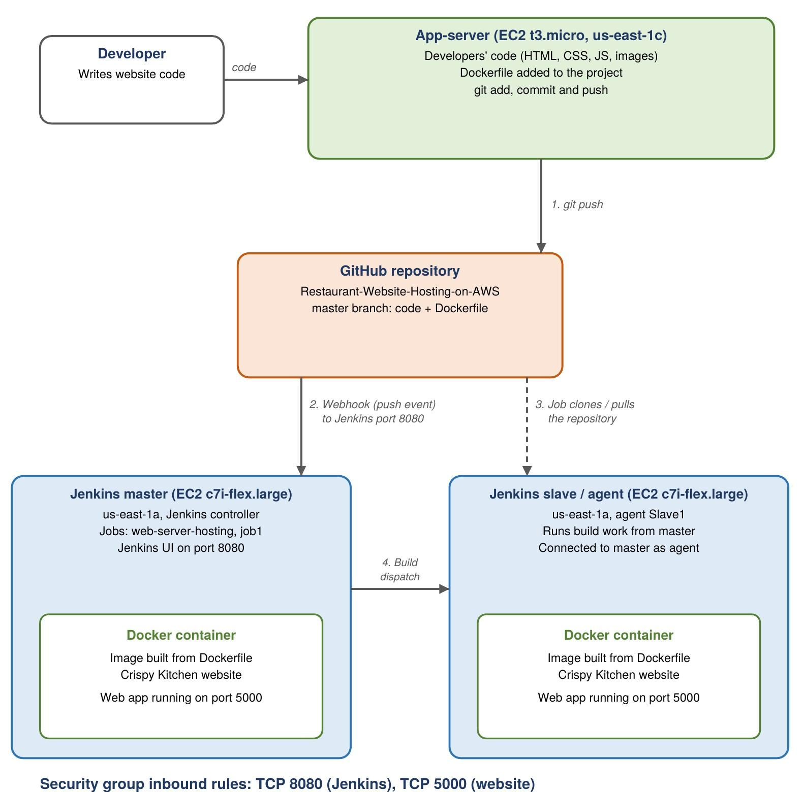

### Request and deployment flow

1. Developer updates the website source code and pushes it to the GitHub `master` branch.
2. GitHub sends a push event to the configured Jenkins webhook endpoint.
3. Jenkins master receives the event and starts the `web-server-hosting` job.
4. Jenkins distributes configured build work to the connected agent (`Slave1`) where applicable.
5. Docker is used to package and run the website.
6. The App-server EC2 instance serves the website to visitors on port **5000**.

## Technology stack

| Area | Technology | Purpose |
|---|---|---|
| Website | HTML, CSS, JavaScript | Static restaurant website frontend |
| Source control | Git, GitHub | Version control and source-code repository |
| CI/CD | Jenkins master and agent | Automates build/deployment jobs |
| Containerization | Docker, Dockerfile | Packages and runs the website |
| Cloud compute | Amazon EC2 | Hosts the app server and Jenkins instances |
| AWS region | `us-east-1` | Deployment region used in this project |

## Repository contents

The website repository documented in this project includes:

```text
Restaurant-Website-Hosting-on-AWS/
├── css/                 # Stylesheets
├── fonts/               # Website fonts
├── images/              # Website images
├── js/                  # JavaScript files
├── video/               # Website video assets
├── index.html           # Main page
├── about.html           # About/story page
├── contact.html         # Contact page
├── Dockerfile           # Docker image instructions
└── README.md
```

The GitHub documentation also includes a `screenshots/` folder with the project evidence shown below. Keep the screenshot filenames and folder structure unchanged so the image links in this README continue to work.

## Implementation summary

### 1. AWS EC2 setup

Three EC2 instances were launched in `us-east-1` and shown as running with successful status checks:

| Instance | Instance type (as documented) | Availability Zone | Role |
|---|---|---|---|
| `App-server` | `t3.micro` | `us-east-1c` | Website host |
| `jenkins-master` | `c7i-flex.large` | `us-east-1a` | Jenkins controller |
| `jenkins-slave` | `c7i-flex.large` | `us-east-1a` | Jenkins build agent |

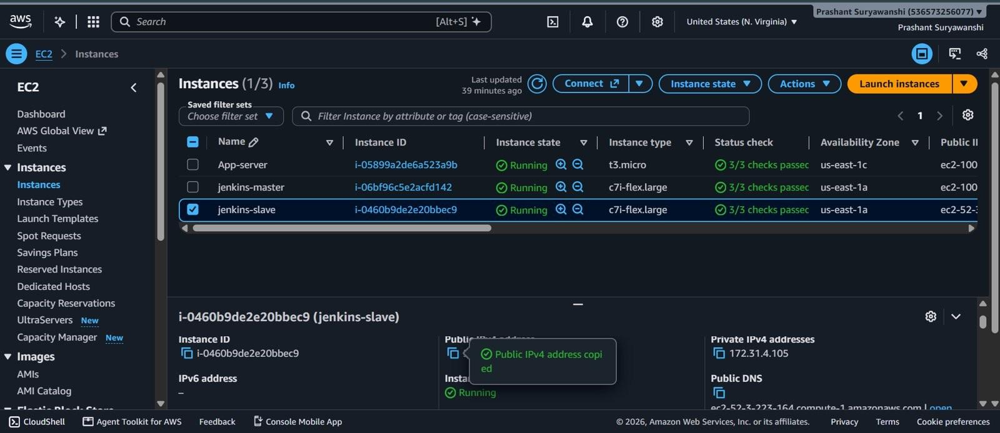

### 2. GitHub source repository

The website source code and Dockerfile are stored in the public GitHub repository `Restaurant-Website-Hosting-on-AWS`.

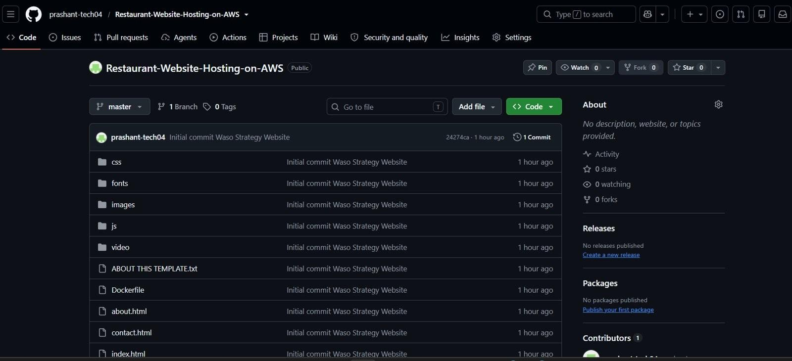

### 3. GitHub webhook integration

A repository push webhook is configured to notify Jenkins when code is pushed. The project documentation records a successful webhook delivery. For security, do not copy a historical server IP or webhook secret into a public README; configure the current Jenkins URL and secret in GitHub settings instead.

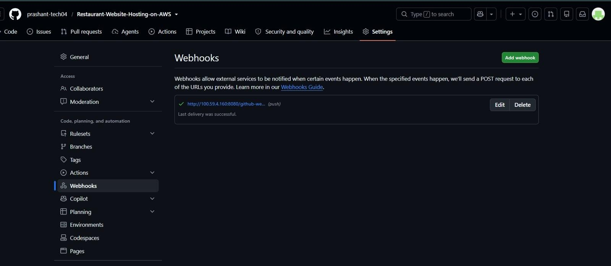

### 4. Jenkins controller and agent

The Jenkins dashboard shows the `job1` and `web-server-hosting` jobs. The Build Executor Status panel shows the Built-In Node and the connected `Slave1` agent.

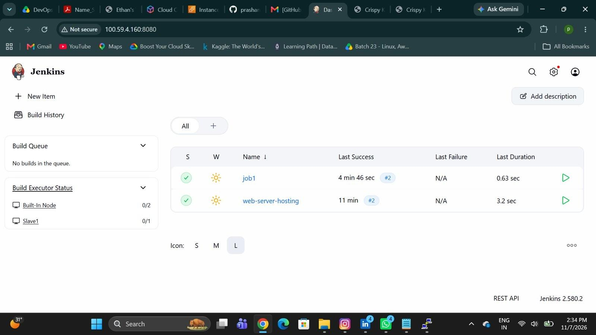

### 5. Website deployment job

The `web-server-hosting` job is configured as a multi-configuration project with `built-in` and `prod` configurations. The documentation records successful build **#2**.

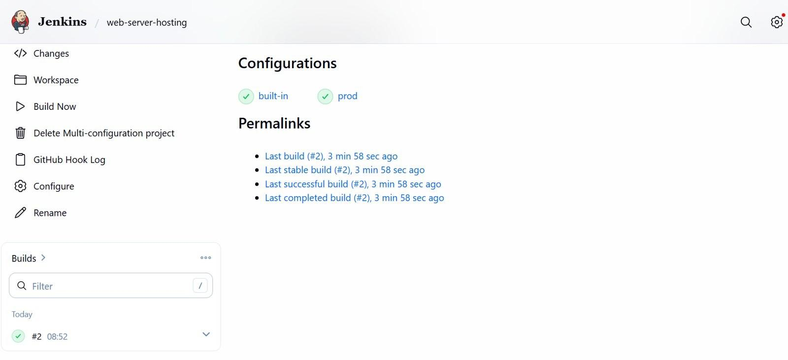

### 6. Pipeline verification

The `job1` verification job shows builds **#1** and **#2** completed successfully.

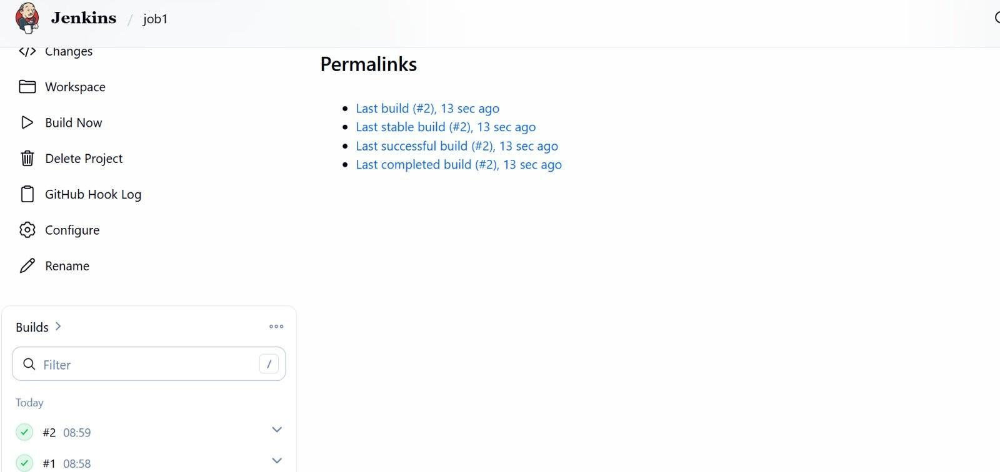

## Deployed website

After deployment, the website was opened in a browser using the App-server address on port `5000`. The captured pages include:

### Home page

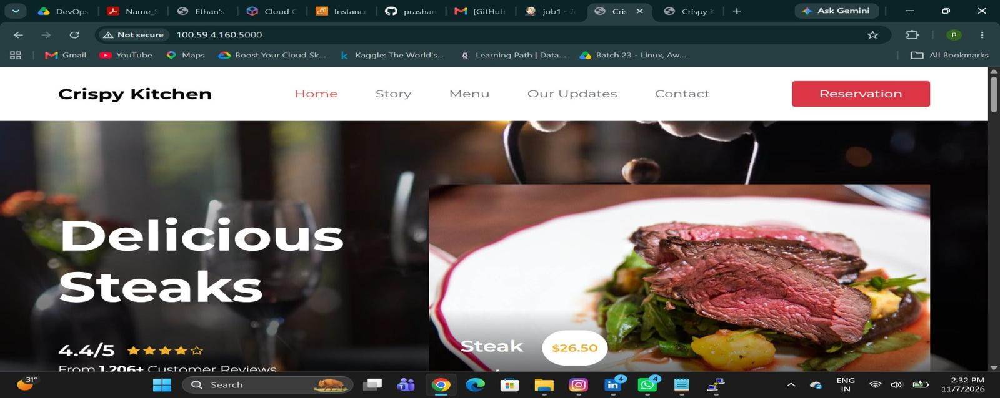

### Special menus

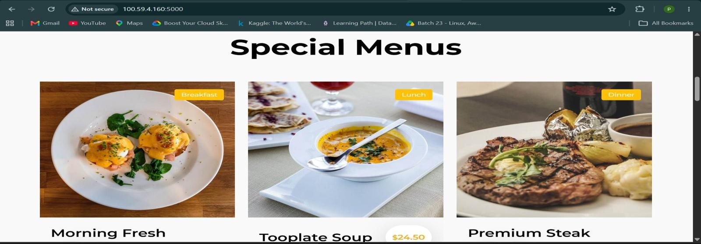

### News and events

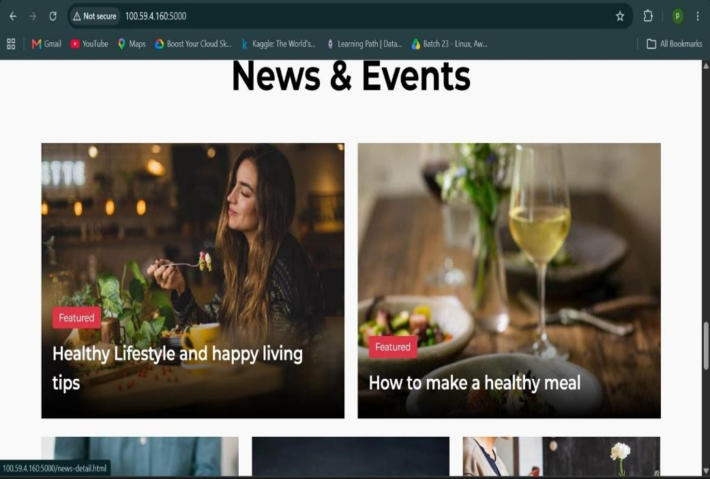

### Footer — location, opening hours and social links

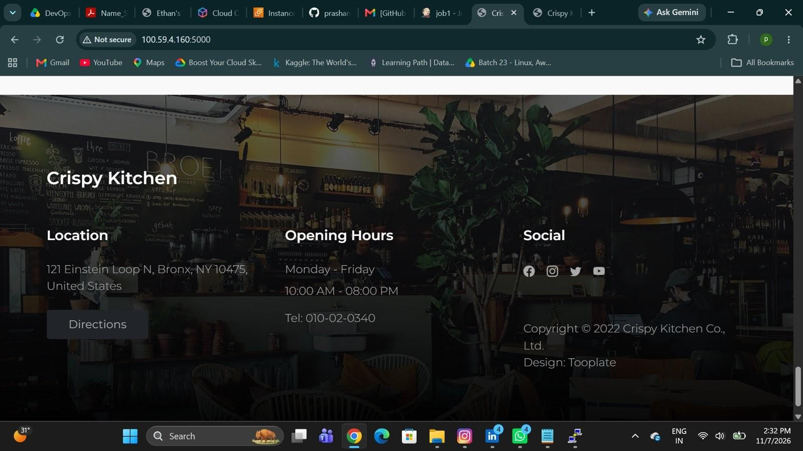

## Verification performed

- [x] Three EC2 instances launched and shown running with successful status checks.
- [x] Website source code and Dockerfile stored in GitHub.
- [x] GitHub push webhook delivery to Jenkins verified successfully.
- [x] Jenkins master and `Slave1` agent connected.
- [x] `job1` and `web-server-hosting` jobs completed successfully.
- [x] Website container deployed on the App-server.
- [x] Home, Special Menus, News and Events, and footer sections checked in a browser.

## How to add this README and screenshots to GitHub

1. Open your `Restaurant-Website-Hosting-on-AWS` repository on GitHub.
2. Upload `README.md` to the repository root (replace the existing README if appropriate).
3. Upload the complete `screenshots` folder, including all 11 image files, to the repository root.
4. Commit the changes to the branch you use (the project documentation shows `master`).
5. Open the repository home page and confirm the architecture and all screenshot images render correctly.

Your GitHub repository should look like this:

```text
Restaurant-Website-Hosting-on-AWS/
├── css/
├── fonts/
├── images/
├── js/
├── video/
├── screenshots/
│   ├── 00-architecture.jpeg
│   ├── 01-ec2-instances.jpeg
│   ├── 02-github-repository.jpeg
│   ├── 03-github-webhook.jpeg
│   ├── 04-jenkins-dashboard.jpeg
│   ├── 05-website-deployment-job.jpeg
│   ├── 06-pipeline-verification-job.jpeg
│   ├── 07-website-homepage.jpeg
│   ├── 08-special-menus.jpeg
│   ├── 09-news-and-events.jpeg
│   └── 10-website-footer.jpeg
├── index.html
├── about.html
├── contact.html
├── Dockerfile
└── README.md
```

## Security notes

- Never commit AWS access keys, private SSH keys (`.pem`), passwords, Jenkins credentials, webhook secrets, or environment files.
- Avoid publishing live public IP addresses or internal infrastructure details unless you intentionally want them public. Use GitHub/Jenkins credentials and secret storage for sensitive values.
- Restrict inbound security-group rules to the ports and source IP ranges required for your setup. Do not leave Jenkins (`8080`) or the website port publicly open without an appropriate access-control decision.

## Author

**Prashant Suryawanshi**

---

*Project details and screenshots in this README are based on the accompanying 12-page Crispy Kitchen AWS project documentation.*
